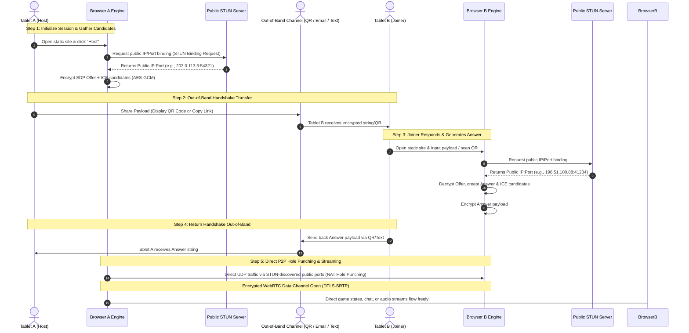

# Overview of 'Serverless' P2P Communications PWA
Two web-based peer-to-peer (P2P) communications pathways.
* LAN: Two devices communicating directly on the same local network.
* WAN: Two devices communicating directly over WAN, like the internet, without a local network.

## Overview of the What
What: A zero-infrastructure, out-of-band WebRTC handshake entirely within a static web application.

Scenario: two devices on completely different networks communicating directly via the internet, using an out-of-band channel like email, text, or a QR code to pass the handshake. This is the exact textbook definition of how a serverless WebRTC connection works.

## Overview of the How
How: Instead of relying on a matchmaking server, the app uses URL hash fragments `(#...)` to pack and pass encrypted connection handshakes back and forth between peers. No servers store your app data, no port forwarding is required on either home router, and once that initial QR code or link is scanned, the secondary communication method (email/text) is no longer needed at all.

To be 100% clear about how it bridges the internet gap:

**The Internet Barrier (NAT):** Even though the two tablets are on different networks behind different home routers, WebRTC uses a public STUN server (like Google's free STUN servers) during the handshake phase. When Tablet A generates its offer, its browser asks a public server: "What is my public-facing IP and port?" It embeds that public routing info into the encrypted payload.

**The Out-of-Band Bridge:** You take that encrypted text string (via QR code, email, or text message) and hand it to Tablet B. Tablet B does the same thing back to you.

**The Direct Internet Connection:** Once both tablets parse each other's public routing data, their browsers open a direct, peer-to-peer UDP/TCP socket straight across the internet from Router A to Router B.

### Conceptual Flow
* **Peer A (Host):** Clicks "Create Connection." The browser generates a WebRTC offer, serializes it to JSON, encrypts it with a local room password, and embeds the ciphertext into the URL hash (`#offer=...`).
* **The Handshake Bridge:** Peer A copies this URL and sends it to Peer B via any messaging app (Discord, email, chat).
* **Peer B (Joiner):** Opens the link. The client reads the hash, decrypts Peer A's offer, generates a WebRTC answer, encrypts it, and places it into a new URL hash `(#answer=...)`. Peer B sends this link back to Peer A.
* **Connection Established:** Peer A opens Peer B's answer link. The direct peer-to-peer data channel opens, and the communcation pathway begins.

### Why this architecture works:
* **Minimal ('Zero') Infrastructure:** The website can be hosted on a standard static bucket. No server logs your data, tracks app state, or manages matchmaking.
* **Client-Side Security:** Because the WebRTC connection metadata contains local network routing clues (IPs/ports), encrypting the payload via AES-GCM ensures that whoever passes the link across chat apps cannot leak sensitive underlying local network topology to third-party messaging services.
* **Low Latency Comms:** Once the URL hash handshaking completes, the data channel opens directly between the two browser clients, allowing arbitrary communications with low latency.

## 1. Underlying Routing Architecture (Mermaid Diagram)
When Tablet A and Tablet B are on entirely separate networks (e.g., different homes or cellular/Wi-Fi mixes), a direct connection requires traversing home routers, Network Address Translation (NAT), public STUN infrastructure, and an external out-of-band pathway.

Example, with a P2P game.

## 2. Architectural Spec & Minimal Requirements
To get this framework running without maintaining backend game servers, you need three core components:
* **Static Web Hosting Layer:** A basic host (GitHub Pages, Vercel, Netlify, or local static file server) to serve your immutable frontend `index.html` and bundled JavaScript. No server-side runtime code is executed.
* **Public STUN Server:** A standard, free public STUN infrastructure (e.g., Google’s public STUN pools: `stun:stun.l.google.com:19302`) used strictly during initialization to help each tablet identify its outer router port mapping.

### Client JavaScript Engine (Zero external dependencies required):
* Native WebRTC APIs (`RTCPeerConnection`, `RTCDataChannel`)
* Native Browser Web Crypto API (`window.crypto.subtle` for AES-GCM encryption of handshake tokens)
* QR Code Generation/Reading utility (optional, but highly recommended for mobile UX—e.g., a tiny embedded JS library like `qrcode.js` or HTML5 QR scanner).

## 3. UI Components & Browser Permissions
When building this for tablets (iOS Safari / Android Chrome), user experience design must account for mobile browser security paradigms.

### Required Permissions & Constraints
* **Secure Context Requirement:** WebRTC and modern cryptographic clipboard APIs strictly require HTTPS (or localhost for development). If hosted via a static site, it must load over `https://`.
* **Local Network Access (LNA):** If devices happen to be on the same local network, modern desktop and mobile browsers trigger a local network permission prompt ("Wants to look for and connect to devices on your local network"). For internet-wide cross-network connections via STUN, local network permissions are bypassed since traffic routes through public UDP port mappings.
* **Clipboard & Camera Permissions:** If using QR codes for the out-of-band handshake, your UI will request camera access (`navigator.mediaDevices.getUserMedia`) for scanning, and clipboard access (`navigator.clipboard`) for copying links.

### Essential UI Layout Components
The Role Selector View: Buttons for `[ Open Channel ]` vs `[ Join Channel ]`.

* **The Security/Password Input:** A shared passphrase field used to derive the AES-GCM encryption key so handshake links cannot be intercepted in transit.
* **The Out-of-Band Bridge Modal:**
    * **For the Host:** A text area with a generated secure URL/token, accompanied by an interactive QR Code canvas rendering the encrypted offer.
    * **For the Joiner:** A text box to paste the string, or a `"Scan QR Code"` button activating the tablet's front/rear camera.
* **The Live Status Indicator:** A reactive badge tracking ICE connection states (checking, connected, disconnected).

## 4. Architectural Extensions (Building On Top of the Framework)
Because the underlying framework establishes a raw, bidirectional, low-latency encrypted pipe (`RTCDataChannel` or media stream track), you can build completely different application types on top of the exact same initialization sequence:

* **Extension A:** Text Chat Channel
    * **Implementation:** Simply call `dataChannel.send(JSON.stringify({ user, text, timestamp }))` whenever a user types a message.
* **Extension B:** Real-Time Strategy (RTS) Game Engine
    * Implementation: Transmit deterministic player commands rather than raw frame coordinates. When a player clicks to build a structure or move a unit, send a compact JSON payload (`{ type: 'CMD_MOVE', units: [1,2], dest: {x, y}, tick: 1042 }`). Both tablets process the command locally on a synchronized deterministic game loop.
* **Extension C:** P2P Audio / Music Streaming
    * **Implementation:** Instead of an `RTCDataChannel`, initialize an `RTCPeerConnection` configured for media tracks. Tablet A can stream microphone audio, web synth output, or an HTML5 media stream (`MediaStreamTrack`) directly through the peer connection to Tablet B's audio output context with zero server overhead.